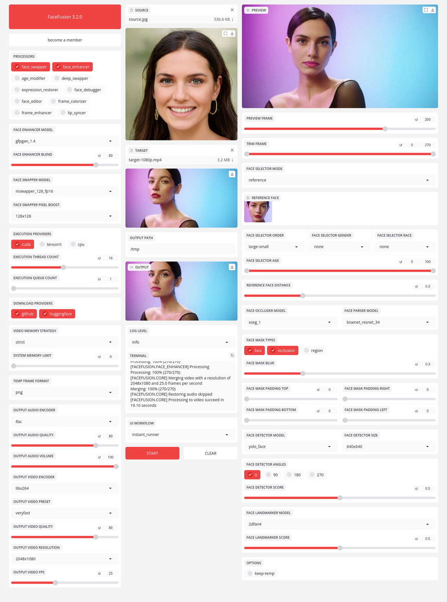

# ComfyUI Portable Setup & Production Custom Nodes Guide

ComfyUI is the industry standard node-based GUI for Stable Diffusion, FLUX, and generative VFX pipelines. Running the standalone portable version gives artists complete environment isolation.

## 1. Download Standalone Portable Release

Download and extract the latest standalone portable release archive from GitHub:
[https://github.com/comfyanonymous/ComfyUI/releases](https://github.com/comfyanonymous/ComfyUI/releases)

---

## 2. Essential Production Custom Nodes

Navigate to `ComfyUI_windows_portable/ComfyUI/custom_nodes/` and clone these essential repositories:

### 1. ComfyUI Manager (Repository & Node Browser)
```bash
git clone https://github.com/ltdrdata/ComfyUI-Manager comfyui-manager
```

### 2. RGThree Tools (Node Routing & Quality of Life)
```bash
git clone https://github.com/rgthree/rgthree-comfy.git
```

### 3. Video Helper Suite (VHS) (Frame Sequences & EXRs)
```bash
git clone https://github.com/Kosinkadink/ComfyUI-VideoHelperSuite.git
```

<div class="blog-grid-2">
  <div class="col-text">
    <h3>Node Graph Organization</h3>
    <p>Using RGThree context nodes and VHS batch loaders allows VFX compositors to feed native 4K image sequences directly through ControlNet inpainting passes without manual frame extraction.</p>
  </div>
  <div class="col-media">
    
  </div>
</div>

---

## 3. Automation Launch Script

Create a root `run_production.bat` launcher that checks git submodules and initializes with high VRAM allocation:

```batch
@echo off
setlocal
cd /d "%~dp0"
echo Starting ComfyUI with High VRAM Allocation...
.\python_embeded\python.exe -s ComfyUI\main.py --windows-standalone-build --highvram --fast
pause
```
