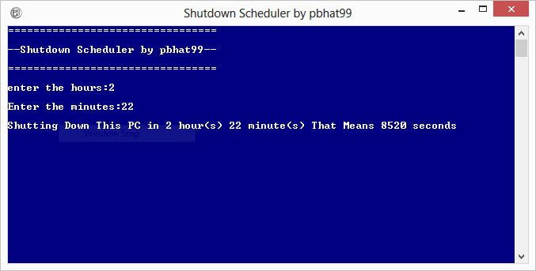

# Automating Deep Compositing Workflows in Nuke with Python

Deep compositing stores multiple color and opacity samples per pixel along the camera ray (Z-depth). While it completely eliminates edge artifacts on complex volumes and volumetric hair/smoke, Deep files can quickly choke comp scripts if not managed procedurally.

## Understanding Deep Data Architecture

Unlike standard flat EXR images that have single values `(R, G, B, A, Z)`, each pixel in a DeepEXR file contains an array of depth ranges:

```
Pixel (x, y):
  Sample 0: Z_front = 10.2, Z_back = 10.5, Alpha = 0.45, Color = (0.2, 0.4, 0.8)
  Sample 1: Z_front = 14.1, Z_back = 18.0, Alpha = 0.85, Color = (0.7, 0.1, 0.0)
```

---

## Python Script: Automated Deep Holdout Generation

This Python utility script scans selected 3D render Read nodes, attaches a `DeepSample` inspector, inserts a `DeepCrop` node with bounding-box optimization, and builds automated holdout mattes:

```python
import nuke

def build_deep_holdout_rig(selection=None):
    """
    Builds an automated Deep holdout rig from selected DeepRead nodes.
    Reduces memory overhead by clipping samples beyond camera frustum.
    """
    nodes = selection or nuke.selectedNodes()
    if not nodes:
        nuke.message("Please select at least one DeepRead or Deep node.")
        return

    for node in nodes:
        if not node.Class().startswith("Deep"):
            continue

        # Create optimized DeepCrop
        crop = nuke.nodes.DeepCrop(inputs=[node])
        crop['use_znear'].setValue(True)
        crop['znear'].setValue(1.0)
        crop['use_zfar'].setValue(True)
        crop['zfar'].setValue(5000.0)

        # Create DeepToImage converter for 2D comp integration
        d2i = nuke.nodes.DeepToImage(inputs=[crop])
        d2i.setXpos(crop.xpos())
        d2i.setYpos(crop.ypos() + 60)

        print(f"Built Deep holdout rig for {node.name()}")

# Run the automation tool
build_deep_holdout_rig()
```

<div class="blog-grid-2">
  <div class="col-text">
    <h3>DeepSample & Optimization</h3>
    <p>Always combine multiple deep volumes using <code>DeepMerge</code> before converting down to flat 2D raster images. Keeping data in Deep space until the final beauty integration preserves sub-pixel optical thickness.</p>
  </div>
  <div class="col-media">
    
  </div>
</div>

> **Performance Rule:** Always place a `DeepCrop` or `DeepReformat` as close to the `DeepRead` node as possible to truncate unnecessary empty air samples before downstream merging.
