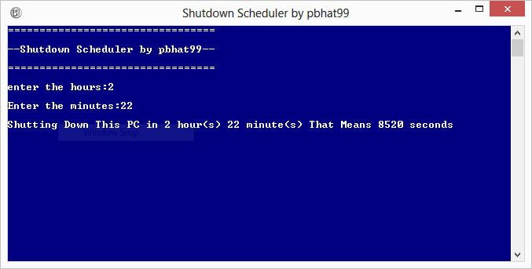

# Camera Projections in Nuke: The Technical Guide

Camera projection is the cornerstone technique in digital matte painting, set extension, and shot cleanup. It allows 2D painted plates to be projected through a 3D camera onto card or geometry surfaces, creating photoreal perspective parallax.

## Core Projection Mechanics

The projection pipeline relies on three elements connected into a `Project3D` node:
1. **Camera**: The frame-locked projection camera matching the reference plate.
2. **Image Texture**: The clean painted plate or texture matte.
3. **Geometry**: 3D cards, lidar geometry, or modelled proxy meshes.

---

## Handling Lens Distortion Correctly

A common pitfall is projecting distorted plates onto 3D geometry:

> **Fundamental Principle:** The 3D world in Nuke is strictly rectilinear (pinhole camera model). Always **undistort** your reference plate before projecting, and re-apply lens distortion onto the final rendered output from the moving render camera.

```
Plate -> LensDistortion (Undistort) -> Clean Paint -> Project3D
                                                           |
Render Camera -> ScanlineRender -> LensDistortion (Distort) -> Beauty Comp
```

---

## Python Tool: Instant Project3D Rig Setup

Here is a Python script that connects a selected Camera and Read node into a complete Project3D rig with projection geometry:

```python
import nuke

def create_projection_rig():
    sel = nuke.selectedNodes()
    cam = next((n for n in sel if n.Class() in ('Camera', 'Camera2', 'Camera3', 'Camera4')), None)
    img = next((n for n in sel if n.Class() == 'Read'), None)

    if not cam or not img:
        nuke.message("Select a Camera node and a Read node to construct the projection rig.")
        return

    # Create FrameHold on projection camera
    cur_frame = nuke.frame()
    fh = nuke.nodes.FrameHold(inputs=[cam])
    fh['firstFrame'].setValue(cur_frame)

    # Create Project3D
    proj = nuke.nodes.Project3D(inputs=[img, fh])
    proj['crop'].setValue(True)

    # Create 3D Card positioned along camera axis
    card = nuke.nodes.Card2(inputs=[proj])
    card['z'].setValue(-100.0)

    # Create ScanlineRender
    sr = nuke.nodes.ScanlineRender(inputs=[card, cam])

    nuke.message(f"Projection rig created at frame {cur_frame}!")

create_projection_rig()
```

<div class="blog-grid-2">
  <div class="col-text">
    <h3>Planar vs Spherical Projections</h3>
    <p>For matte painting horizons and sky domes, spherical mapping onto a <code>Sphere</code> node provides seamless 360-degree panning. For building facades and ground planes, planar projection cards aligned with surveyed tracking points offer zero distortion.</p>
  </div>
  <div class="col-media">
    
  </div>
</div>

---

## Summary Best Practices
- Freeze the projection camera with a `FrameHold` at the hero alignment frame.
- Enable `crop` on the `Project3D` node to prevent UV bleeding beyond geometry bounds.
- Use `Reconcile3D` to track card surface points for seamless 2D element integration.
